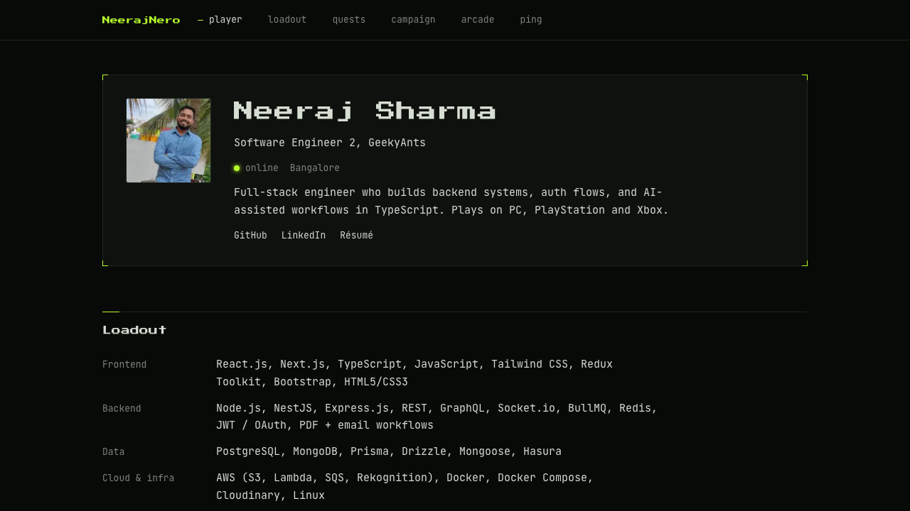

# neerajnero.com



A personal portfolio built as a player profile: dark, mono-spaced, one acid-green accent, HUD framing. Résumé content, a quest log of GitHub projects, and a trophy case that pulls live stats from Steam, Xbox and PlayStation.

Live at <https://www.neerajnero.com>.

## Stack

Next.js 16 (App Router, Cache Components) · React 19 · TypeScript strict · Tailwind CSS v4 · `psn-api` · pnpm · Vercel. No component library; every component is hand-rolled.

## How the arcade works

Three server-side adapters, one per platform, each cached for an hour with `"use cache"`. Steam uses the Web API, Xbox goes through OpenXBL, PlayStation through `psn-api`. Each adapter validates the response shape and throws on anything empty, and a single wrapper logs one redacted warning and falls back to a hand-filled snapshot from `src/config/site.ts`. The site builds and renders with no keys at all; cards then show a small "snapshot" label instead of "live HH:MM IST". Keys never appear in logs, warnings or the debug route.

## Local setup

```bash
pnpm install
cp .env.example .env.local   # fill in what you have; every variable is optional
pnpm dev                     # http://localhost:3000
```

`pnpm typecheck`, `pnpm lint` and `pnpm build` must pass before a commit. In development, `GET /api/trophy-case` returns the arcade data as JSON for checking keys; it returns 404 in production.

## Documentation

Start at [docs/README.md](docs/README.md): architecture, content schema, design system, the arcade adapters, deployment and DNS, a runbook, decisions, and the changelog. The original build spec is frozen at [docs/spec.md](docs/spec.md).

## Fonts

Press Start 2P and JetBrains Mono, both under the SIL Open Font License. Copies and licence texts are in `src/app/fonts/` for the Open Graph image.
